# Ingressos Smart

App Android (Kotlin + Jetpack Compose) para **venda de ingressos de eventos locais** com pagamento pela
**Cielo Smart** (Deep Link `lio://`). Com foco em fluxo de compra curto, **zero cobrança duplicada**,
tratamento explícito de erros e testes nos cenários críticos.

| Eventos | Checkout | Terminal (simulador) | Pagamento aprovado | Ingressos com QR |
|---|---|---|---|---|
| 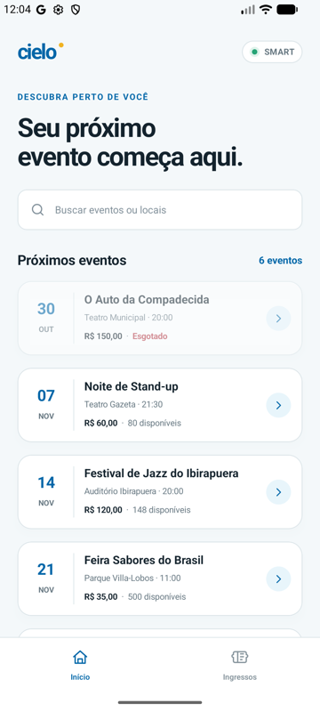 | 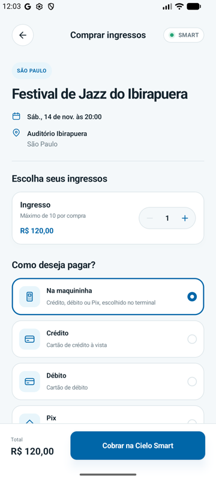 | 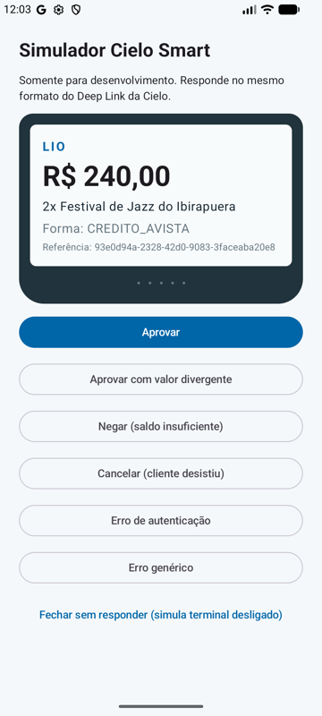 | 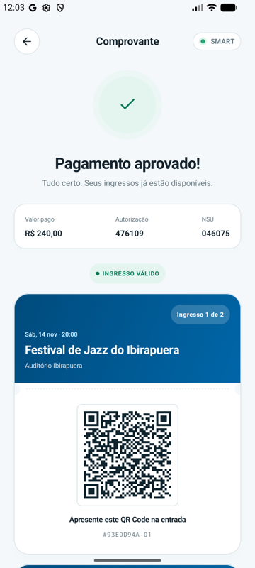 | 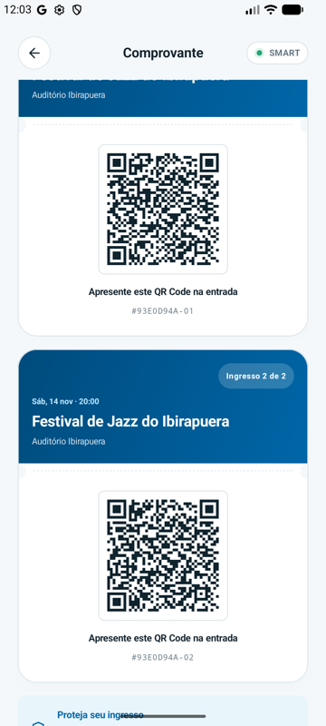 |

| Aguardando terminal | Sem retorno do terminal | Não aprovado | Meus ingressos |
|---|---|---|---|
| 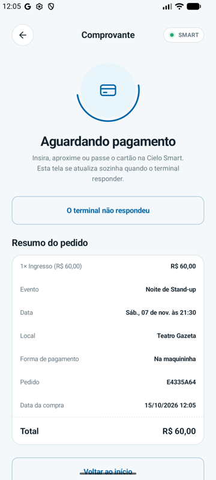 | 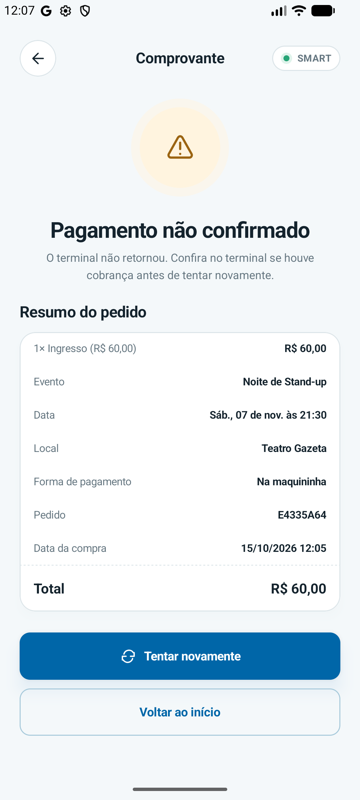 | 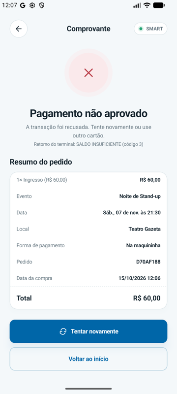 | 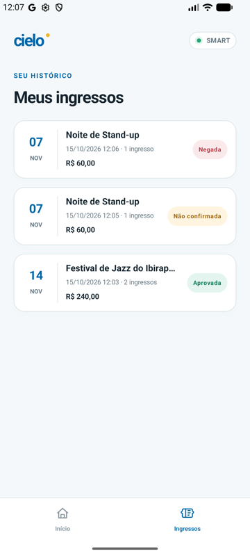 |

## Sumário

1. [Como executar](#1-como-executar)
2. [Funcionalidades](#2-funcionalidades)
3. [Decisões arquiteturais](#3-decisões-arquiteturais) (inclui a identidade visual)
4. [Integração com a Cielo Smart](#4-integração-com-a-cielo-smart)
5. [Prevenção de cobrança duplicada](#5-prevenção-de-cobrança-duplicada)
6. [Tratamento de erros](#6-tratamento-de-erros)
7. [Segurança](#7-segurança)
8. [Testes](#8-testes)
9. [Bibliotecas externas e justificativas](#9-bibliotecas-externas-e-justificativas)
10. [Uso de IA (harness do agente)](#10-uso-de-ia-harness-do-agente)
11. [Trade-offs](#11-trade-offs)
12. [O que faria com mais tempo](#12-o-que-faria-com-mais-tempo)

---

## 1. Como executar

### Pré-requisitos

- Android Studio recente (ou só o Android SDK) com **SDK 36** instalado
- **JDK 17+** (o JDK embarcado no Android Studio serve)
- Um emulador ou dispositivo Android **7.1 (API 25) ou superior**

### Duas variantes (product flavors)

O app tem duas variantes. **O código de integração é o mesmo nas duas.** Muda apenas quem responde ao Deep Link:

| Flavor | Quem responde ao pagamento | Quando usar |
|---|---|---|
| `simulator` | **Simulador de terminal** embutido (`lio-sim://`), que responde no **mesmo formato** da Cielo | Rodar em qualquer emulador/dispositivo, demos e revisão |
| `cielo` | **Cielo Smart**: terminal real ou [Emulador Cielo oficial](https://docs.cielo.com.br/cielo-smart/docs/baixando-o-emulador-cielo) (`lio://`) | Integração real |

### Caminho rápido (simulador, qualquer emulador)

Com o emulador aberto basta executar o comando:
```bash
./gradlew :app:installSimulatorDebug
```

Abra **Ingressos Smart**, escolha um evento, a quantidade e toque em **Pagar**. O simulador abre como se
fosse o app da Cielo, com as opções *Aprovar*, *Aprovar com valor divergente*, *Negar*, *Cancelar*,
*Erro de autenticação*, *Erro genérico* e *Fechar sem responder*.

### Com o Emulador Cielo oficial

1. Crie um AVD **Android 10 (API 29)** ou **7.1 (API 25)**. O Emulador Cielo só roda nessas versões ([docs](https://docs.cielo.com.br/cielo-smart/docs/baixando-o-emulador-cielo)).
2. Instale o APK do emulador indicado na documentação da Cielo (`adb install lio-emulator.apk`).
3. (Opcional) Informe suas credenciais do [Portal de Desenvolvedores](https://desenvolvedores.cielo.com.br/api-portal/) em `local.properties`, que já é ignorado pelo git:
   ```properties
   cielo.clientId=SEU_CLIENT_ID
   cielo.accessToken=SEU_ACCESS_TOKEN
   ```
   Também são aceitas as variáveis de ambiente `CIELO_CLIENTID` e `CIELO_ACCESSTOKEN` (útil em CI).
4. Instale e use o app:
   ```bash
   ./gradlew :app:installCieloDebug
   ```

### Testes

```bash
./gradlew test                     # 69 testes unitários (JVM + Robolectric), todos os módulos
./gradlew lintSimulatorDebug       # Android Lint
```

### Status de validação (transparência)

| O quê | Como foi validado |
|---|---|
| Regras de negócio, idempotência, máquina de estados | 69 testes automatizados. O teste de duplo toque foi checado por "mutação": falha se o lock for removido |
| Parser da resposta da Cielo | Testado com os **payloads de exemplo publicados na documentação oficial** (sucesso e erro) e com os **3 callbacks reais capturados do Emulador Cielo oficial** (`payment/cielo/src/test/resources/cielo/emulator-1.61.8-*.uri`) |
| Fluxo ponta a ponta (flavor `simulator`) | Executado no emulador Android (API 37), também após aplicar a identidade visual: aprovação, negação, cancelamento, terminal sem resposta, pagamento concorrente bloqueado, callback repetido, callback forjado e **morte do processo do app durante o pagamento** |
| Flavor `cielo` contra o **Emulador Cielo oficial** (v1.61.8, AVD Android 10 / API 29) | **Executado** em 15/10/2026: 2 ingressos de R$ 60,00 nos três cenários do emulador. **Sucesso** → `APPROVED`, R$ 120,00, 2 ingressos com QR; **Cancelado** → `CANCELED` (código 1); **Erro** → `FAILED` (código 2). Nenhuma mudança de código foi necessária |
| Terminal físico Cielo Smart | Não executado (sem acesso a terminal) |

O que o emulador oficial confirmou (e que os testes agora fixam):

- A aprovação **ecoa o `reference`** (= id da compra), então a correlação e a idempotência funcionam como projetado.
- O Base64 da resposta vem **quebrado a cada 76 caracteres com `\n` cru** (sem percent-encoding) e com `\n` final, o que o decoder tolerante já tratava.
- `paidAmount` vem **`0`** num pedido `PAID`; o valor pago sai da soma dos pagamentos autorizados (`amount` = 12000), que é o fallback do parser.
- `responsecode=0` no sucesso e no cancelamento; no cenário **Erro** o parâmetro `responsecode` **nem vem**. O parser decide pelo JSON, então nada muda.
- Erro e cancelamento chegam sem `reference` (`{code, reason}`) e resolvem a única compra pendente, como previsto.

| Emulador Cielo: checkout | Cenários | Sucesso | Cancelado | Erro |
|---|---|---|---|---|
| 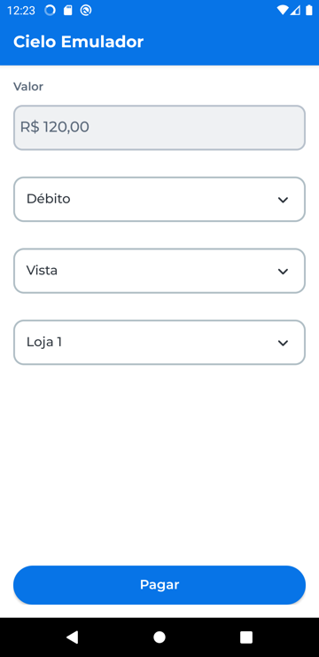 | 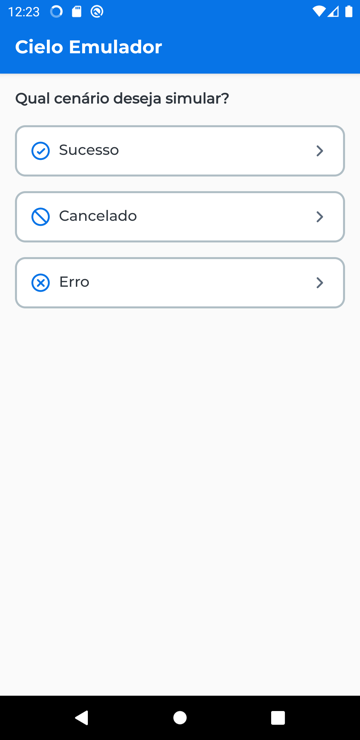 | 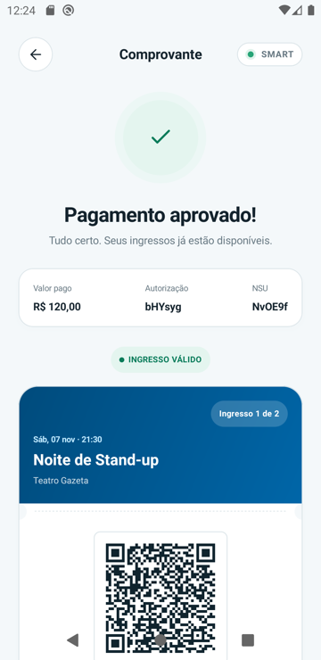 | 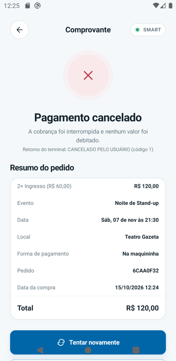 | 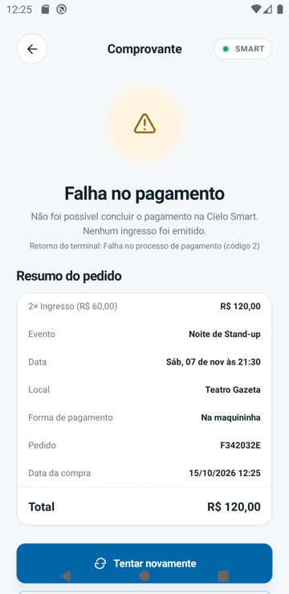 |

---

## 2. Funcionalidades

| Requisito do desafio | Onde está |
|---|---|
| 1. Visualizar eventos disponíveis | `EventsScreen`: data, local, preço, disponibilidade (esgotado / últimos ingressos) e **busca** sem acento/maiúsculas (`Event.matches`) |
| 2. Selecionar quantidade | `CheckoutScreen`: limitada a `min(estoque, 10)`, regra no domínio (`Event.checkQuantity`) |
| 3. Iniciar e concluir pagamento via Cielo | `StartPurchaseUseCase` → `CieloDeepLinkTerminal` (`lio://payment`) → callback → `ProcessPaymentResultUseCase` |
| 4. Registrar resultado (aprovada, negada, cancelada) | Room. Estados `APPROVED`, `DECLINED`, `CANCELED`, `FAILED` e `UNCONFIRMED`; histórico na aba *Ingressos* |
| 5. Exibir comprovante/resumo | `ReceiptScreen`: resumo da compra, dados Cielo (autorização, NSU, cartão, terminal) |
| QR Code (opcional) | Um ingresso digital com QR por unidade, **emitidos apenas na transição para `APPROVED`**, atrelados à compra |
| Extra: forma de pagamento | Crédito, Débito, Pix ou "Na maquininha" (o operador escolhe no terminal) |
| Extra: pagamento sem retorno | Botão "O terminal não respondeu" libera a venda sem perder uma aprovação tardia |

---

## 3. Decisões arquiteturais

Registros completos em [`docs/adr`](docs/adr). Resumo:

### Clean Architecture em módulos Gradle

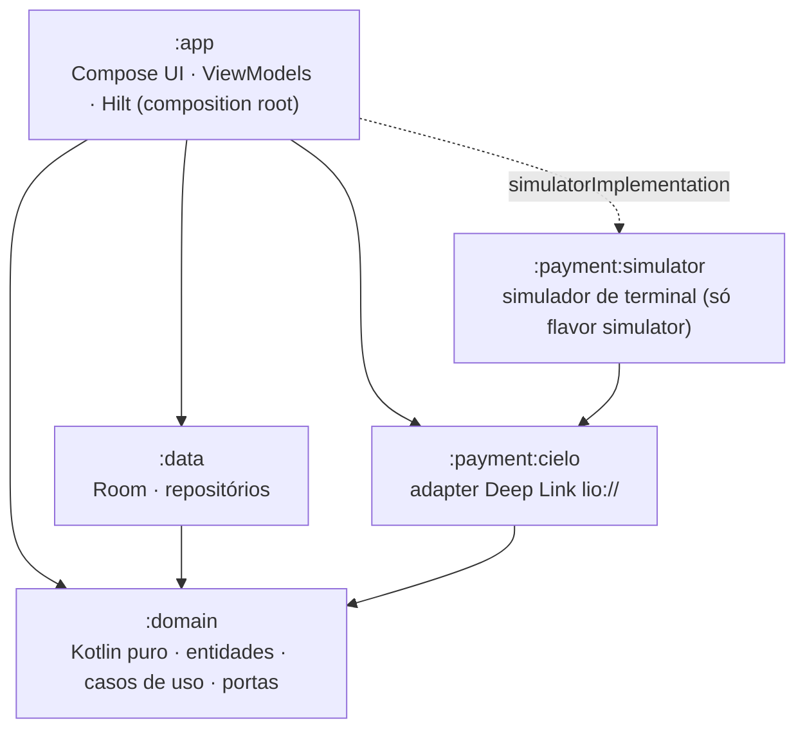

- **`:domain` é Kotlin/JVM puro**: sem Android, sem Room, sem anotações de DI. A regra de dependência é
  garantida pelo **compilador**: o domínio não consegue importar nada de fora.
- **Portas e adaptadores**: o domínio declara `PaymentTerminal`, `PaymentResultParser`, `PurchaseRepository`,
  `EventRepository`, `TransactionRunner`, `Clock`, `IdGenerator` e `Telemetry`. Os módulos externos implementam.
- **`:data` só exporta interfaces do domínio** (via `DataLayer`). O Room nem aparece no classpath do `:app`.
- **`:app` é o composition root**: os módulos Hilt montam o grafo e nenhuma outra camada conhece o framework de DI.
- **UI reativa com fonte única da verdade**: telas observam o banco (`Flow`). O comprovante sai de
  "aguardando" para "aprovado" sozinho quando o callback é gravado, inclusive após morte do processo.

### SOLID na prática

| Princípio | Onde aparece |
|---|---|
| **S**RP | Um caso de uso por intenção (`StartPurchase`, `ProcessPaymentResult`, `ReleasePendingPurchase`). Parsing (`CieloCallbackParser`), montagem do deep link (`CieloDeepLinkFactory`) e disparo (`CieloDeepLinkTerminal`) separados |
| **O**CP | Trocar o meio de pagamento (outro terminal, TEF, API remota) = nova implementação de `PaymentTerminal`/`PaymentResultParser`, sem tocar domínio ou UI. O flavor `simulator` prova isso |
| **L**SP | Os fakes de teste honram os mesmos contratos das implementações reais (ex.: `InMemoryPurchaseRepository` reproduz o compare-and-set do Room). Os casos de uso funcionam igual com qualquer um |
| **I**SP | `PaymentTerminal` (despachar) e `PaymentResultParser` (interpretar callback) são portas separadas, cada uma usada por um cliente diferente |
| **D**IP | Casos de uso dependem de abstrações do próprio domínio. Implementações concretas são injetadas no composition root |

### Clean Code

- Nomes do domínio de negócio (`Purchase.resolve`, `markUnconfirmed`, `findAwaitingTerminal`)
- Dinheiro como `Money` em **centavos (`Long`)**: sem `Double`, no mesmo formato da Cielo
- Erros **tipados** (`sealed interface`), sem exceções para fluxo esperado e sem `null` como erro
- Entidades imutáveis (`data class` + `copy`); a máquina de estados vive na entidade `Purchase`
- Textos de UI só em `strings.xml`: o domínio expõe `StatusReason` tipado, e a UI escolhe a mensagem

### Identidade visual e design system

A UI aplica a identidade visual criada no Figma Make ("Visual Identity for Ticket App") como um
**design system próprio** em `app/.../ui/designsystem` ([ADR-0009](docs/adr/0009-design-system-identidade-visual.md)):

- **Tokens 1:1 com o CSS da identidade** (`BrandColors`, `BrandRadius`): azul Cielo `#0066A8`, canvas `#F4F8FA`, tinta `#14232D`, sucesso/perigo/alerta com versões suaves, raios 12/18/24.
- **Tipografia** na escala do design (display 34, título 27, resultado 25, seção 18…), em `BrandTypography`.
- **Ícones de traço portados do SVG original** (`BrandIcons`, grade 24 e traço 1.8), sem depender de um pacote de ícones.
- **Componentes**: cabeçalho com logo e pílula "Smart", cards com borda fina, stepper em pílula, cards de forma de pagamento, botões primário/secundário, ingresso digital com picote e QR, estados de resultado com halo e anel de processamento, barra inferior **Início / Ingressos**.
- As telas só usam esses componentes e tokens. Mudar a marca é mexer em um único pacote.

Adaptações conscientes: o fluxo continua em **checkout único** (o design tinha resumo e pagamento em
telas separadas; a Cielo recomenda o mínimo de passos no terminal). Os cards de evento **não usam fotos
remotas**: terminal offline-first, sem dependência de rede nem de biblioteca de imagens. A fonte **DM Sans**
está parametrizada em `BrandFont` e usa a sans-serif do sistema até os arquivos `.ttf` (licença OFL)
serem adicionados em `res/font`.

### Fluxo de pagamento

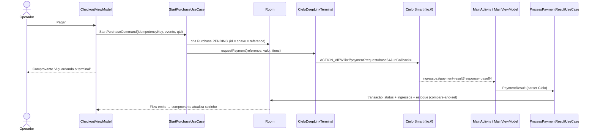

### Máquina de estados da compra

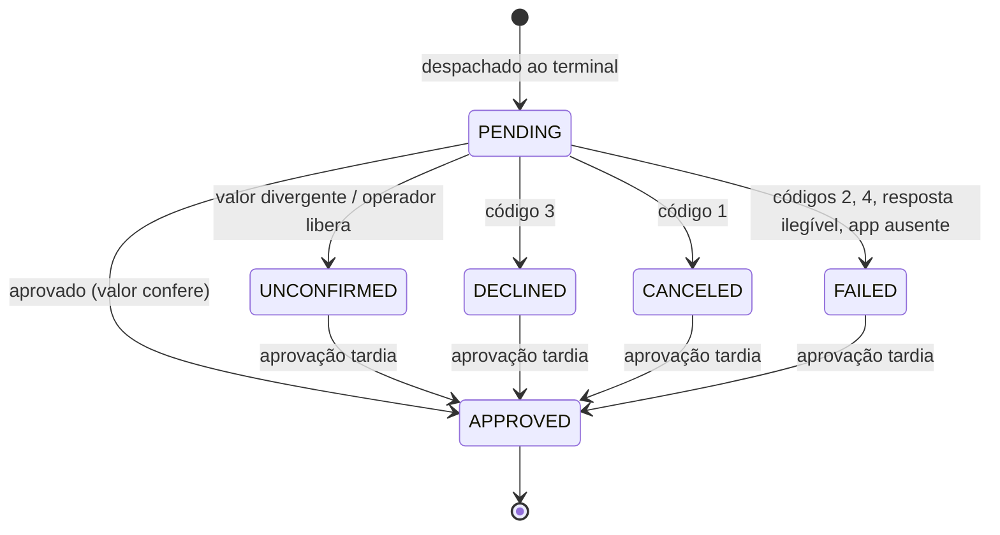

Regra-chave: **uma aprovação nunca é perdida**. Ela carrega prova de captura (NSU/autorização) e por isso
prevalece sobre qualquer estado não aprovado. Já `APPROVED` é final e ignora qualquer callback posterior.

---

## 4. Integração com a Cielo Smart

**Modelo escolhido: Deep Link `lio://` (integração local).** A [política de integração da Cielo](https://docs.cielo.com.br/cielo-smart/docs/politica-de-integracao-camada-de-abstracao-obrigatoria)
torna obrigatória a camada de abstração (UriApp / `lio://`) e proíbe o acesso direto ao SDK do fabricante
([ADR-0002](docs/adr/0002-deep-link-lio.md)).

**Requisição.** JSON → Base64 (sem quebras) → valores *percent-encoded*, como o `Uri.Builder` do sample oficial:

```
lio://payment?request=<base64>&urlCallback=ingressos%3A%2F%2Fpayment-result
```

```json
{
  "accessToken": "...", "clientID": "...",
  "reference": "<id da compra = chave de idempotência>",
  "installments": 0,
  "items": [{ "name": "Festival de Jazz", "quantity": 2, "sku": "evt-jazz", "unitOfMeasure": "unidade", "unitPrice": 12000 }],
  "paymentCode": "CREDITO_AVISTA",
  "value": "24000"
}
```

- Valores em **centavos**; `value` como string, conforme a documentação.
- `paymentCode` é omitido quando o operador escolhe "Na maquininha". Mapeamento: `CREDITO_AVISTA`, `DEBITO_AVISTA`, `PIX`.

**Resposta.** A Cielo abre `urlCallback?response=<base64>&responsecode=<n>`.

| JSON recebido | Resultado no domínio |
|---|---|
| Pedido com `payments` autorizados (`statusCode` 0 = Pix, 1 = autorizado) | `Approved` com NSU (`cieloCode`), autorização, cartão, terminal |
| `{"code":1,"reason":...}` | `Canceled` (cancelado pelo usuário) |
| `{"code":3,...}` | `Declined` (erro no pagamento / negado) |
| `{"code":2,...}`, `{"code":4,...}`, código desconhecido | `Failed` (genérico / autenticação) |
| Base64/JSON inválido, sem `response` | `Failed` sem referência (nunca lança exceção) |

Detalhes que vieram da leitura da documentação e viraram código:

- `responsecode` vem `0` **também em erros**, então o parser decide pelo **formato do JSON**.
- Os exemplos da documentação têm **Base64 com quebras de linha**. O decoder é tolerante a `\n` e a `+` convertido em espaço.
- **Correlação pelo `reference`**: a Cielo devolve o `reference` enviado, e esse é o id da compra.
  Respostas de erro não trazem `reference`, então valem apenas para a compra que está aguardando o
  terminal (só existe uma por vez).
- `AndroidManifest`: `<queries>` para `com.ads.lio.uriappclient` (Android 11+) e `meta-data cs_integration_type=uri` (exigido pela Cielo Store).
- O parser é testado com os **payloads reais publicados na documentação** (`CieloCallbackParserTest`).

---

## 5. Prevenção de cobrança duplicada

Defesa em camadas: cada camada cobre um tipo diferente de "reenvio de ação".

| # | Camada | Protege contra | Onde |
|---|---|---|---|
| 1 | Botão desabilitado + flag `isSubmitting` | Duplo toque | `CheckoutViewModel` |
| 2 | **Chave de idempotência por checkout**, salva no `SavedStateHandle` | Reenvio após rotação ou morte do processo | `CheckoutViewModel` |
| 3 | **Single-flight** (`Mutex`) em "verificar + criar + despachar" | Chamadas concorrentes | `StartPurchaseUseCase` (singleton) |
| 4 | **Replay**: chave já usada devolve a compra existente, sem novo despacho | Reenvio com a mesma chave | `StartPurchaseUseCase` |
| 5 | **Um pagamento por vez**: compra `PENDING` bloqueia outros checkouts | Duas vendas simultâneas no mesmo terminal | `StartPurchaseUseCase` |
| 6 | **PK = chave de idempotência** no Room | Bug que pule as camadas acima | `PurchaseEntity` |
| 7 | **Compare-and-set** do status dentro de transação | Callback duplicado ou corrida com "liberar" | `PurchaseDao.updateIfStatus` |
| 8 | **Persist-before-dispatch** | Callback chegando após morte do processo | `StartPurchaseUseCase` |
| 9 | "Tentar novamente" = nova tela de checkout = **nova chave** | Retentativa só por decisão explícita do operador | Navegação |

---

## 6. Tratamento de erros

| Cenário | Comportamento |
|---|---|
| App da Cielo não instalado | Compra `FAILED` ("nada foi cobrado") + comprovante com "Tentar novamente" |
| Negado / cancelado / erro de autenticação | Status específico + mensagem e código do terminal |
| Resposta ilegível | `FAILED` sem referência. Uma aprovação válida que chegue depois ainda vence |
| Valor aprovado ≠ total | `UNCONFIRMED`, **sem emitir ingressos**, orientando conferência ou estorno no terminal |
| Terminal nunca responde | Operador toca "O terminal não respondeu" → `UNCONFIRMED`. Novas vendas liberadas; uma aprovação tardia ainda é registrada |
| Callback desconhecido ou forjado | Ignorado + aviso ("não corresponde a nenhuma compra") |
| Callback repetido / reentrega pelo Recents | Idempotente: não muda nada |
| Morte do processo durante o pagamento | Callback reabre o app, grava o resultado e mostra o comprovante (testado no emulador) |
| Pagamento concorrente | Snackbar "Já existe um pagamento aguardando o terminal" com atalho "Ver" |
| Erro inesperado ao iniciar | Mensagem genérica; nenhum estado inconsistente |

---

## 7. Segurança

- **Credenciais fora do git** (`local.properties`/variáveis de ambiente). `CieloConfig.toString()` e o DTO de request mascaram o token.
- **Esquema de callback exclusivo** (`ingressos://payment-result`, e não o `order://response` dos exemplos), para que outro app do terminal não receba nossos resultados. **Sem categoria `BROWSABLE`**: páginas web não disparam o callback.
- **Callback não é confiável por padrão**: aprovação só é aceita se o `reference` corresponder a uma compra conhecida **e** o valor bater com o total. Caso contrário vira `Unmatched` ou `UNCONFIRMED` e nenhum ingresso é emitido.
- `allowBackup=false` (dados de pagamento fora de backup), R8 no release, telemetria sem dados de cartão ou token.
- Limitação conhecida: o `accessToken` do Deep Link fica no APK, porque o modelo da integração exige. Mitigação ideal: token buscado de um backend em runtime (ver seção 12).

---

## 8. Testes

**69 testes**, todos executáveis com `./gradlew test`. Uso **fakes em vez de mocks** ([ADR-0008](docs/adr/0008-fakes-em-vez-de-mocks.md)).
Eles ficam em `domain/src/testFixtures` e são reutilizados por todos os módulos.

| Módulo | Suites | O que garante |
|---|---|---|
| `:domain` | `PurchaseTest`, `EventTest`, `StartPurchaseUseCaseTest`, `ProcessPaymentResultUseCaseTest`, `ReleasePendingPurchaseUseCaseTest` | Máquina de estados, regras de quantidade, busca sem acento, **duplo toque concorrente → 1 cobrança**, replay, bloqueio de concorrência, callback duplicado, forjado, valor divergente, aprovação tardia, corrida com "liberar" |
| `:data` (Robolectric) | `RoomPurchaseRepositoryTest`, `RoomEventRepositoryTest` | Unicidade da chave no banco, compare-and-set real, mapeamentos, seed do catálogo, **callback duplicado no SQLite real** |
| `:payment:cielo` | `CieloCallbackParserTest`, `CieloDeepLinkFactoryTest` | Payloads da documentação oficial, todos os códigos de erro, Base64 com quebras e `+`, contrato do request, encoding |
| `:payment:simulator` | `TerminalSimulatorTest` | Ida e volta factory → simulador → parser (o simulador fala o mesmo protocolo) |
| `:app` | `CheckoutViewModelTest`, `MainViewModelTest`, `QrCodeEncoderTest` | Duplo toque na UI, chave sobrevive à recriação, callback repetido/desconhecido, QR decodificável |

---

## 9. Bibliotecas externas e justificativas

| Biblioteca | Por quê |
|---|---|
| **Jetpack Compose + Material 3** | UI declarativa (Material Design, recomendado pela Cielo). O Material 3 serve de base técnica; a aparência vem do design system da identidade visual |
| **Navigation Compose** (rotas type-safe) | Argumentos tipados; `popUpTo` garante que um checkout já usado não volte a ser aberto |
| **Hilt** | DI em tempo de compilação, padrão Android, integra com `ViewModel`/`SavedStateHandle` |
| **Room** | Persistência com transações (`withTransaction`) e `Flow` reativo: fonte única da verdade e base do compare-and-set |
| **Kotlin Coroutines/Flow** | Assíncrono estruturado, `Mutex` para single-flight, UI reativa |
| **kotlinx.serialization** | JSON sem reflexão (seguro com R8). Usado no contrato Cielo, catálogo e rotas |
| **ZXing core** | Geração de QR Code sem dependências de UI (só o encoder) |
| **desugar_jdk_libs** | `java.time` no Android 7.1 (terminal L300 v3) |
| **JUnit + kotlin.test + Turbine + kotlinx-coroutines-test** | Testes legíveis de código assíncrono e de `Flow` |
| **Robolectric** | Testar Room/SQLite real na JVM, sem emulador |

Fora da lista de propósito: Retrofit/OkHttp (não há backend, ver trade-offs), MockK (preferência por fakes)
e SDK do fabricante (proibido pela Cielo).

---

## 10. Uso de IA (harness do agente)

A solução foi construída com **Claude Code** como agente de engenharia, guiado por um *harness* versionado no repositório:

| Artefato | Conteúdo |
|---|---|
| [`CLAUDE.md`](CLAUDE.md) | Regras do agente: arquitetura, invariantes de pagamento, convenções, comandos, *definition of done*, proibições |
| [`docs/specs`](docs/specs) | Specs que orientaram a implementação (fluxo de venda, contrato Cielo, idempotência) com critérios de aceite ligados aos testes |
| [`docs/adr`](docs/adr) | Decisões arquiteturais e trade-offs |
| [`docs/ai/USO-DE-IA.md`](docs/ai/USO-DE-IA.md) | Como a IA foi usada: prompts, restrições, verificações e **achados da pesquisa que mudaram o design** |

Em resumo, a IA pesquisou fontes primárias (documentação da Cielo e repositórios oficiais), escreveu specs
e ADRs antes do código e implementou por camada com testes junto. Também verificou o próprio trabalho:
fez checagem por mutação do teste de concorrência e rodou o fluxo ponta a ponta no emulador, e essa
execução encontrou e corrigiu um bug de UI.

---

## 11. Trade-offs

| Decisão | Ganho | Custo |
|---|---|---|
| Deep Link em vez de API remota (Order Manager) | Funciona offline no terminal, sem backend, e segue a política da Cielo | Credenciais no APK. A conciliação fica limitada ao que o terminal devolve |
| Sem backend; catálogo em JSON local semeando o Room | Foco no que é avaliado (app + integração) | Estoque é local ao terminal. Vários terminais exigiriam reserva no servidor |
| Room como fonte única + persist-before-dispatch, **sem foreground service** | Resiliente à morte do processo (verificado no emulador) sem notificação persistente | A Cielo recomenda o foreground service como cinto de segurança extra (ver seção 12) |
| Um pagamento por vez | Correlação simples e segura de callbacks sem `reference` | Não paraleliza vendas (o terminal também não paraleliza) |
| `UNCONFIRMED` em vez de `FAILED` quando não há retorno | Nunca marca como falha algo que pode ter sido cobrado | O operador precisa conferir manualmente no terminal |
| Módulos Gradle | Regra de dependência garantida pelo compilador; build incremental | Mais arquivos de build para um app pequeno |
| Hilt só no `:app`, domínio sem anotações | Domínio 100% puro e portátil | Composition root mais verboso (`@Provides` explícitos) |
| Flavor `simulator` | Qualquer pessoa roda e testa sem hardware ou emulador específico | Mais um módulo para manter (fica fora do APK `cielo`) |

---

## 12. O que faria com mais tempo

1. **Conciliação automática** de compras `UNCONFIRMED` via `lio://orders` (lista os últimos pedidos com `reference`) ou pela API remota do Order Manager.
2. **Foreground service** durante o pagamento, como recomendado pela Cielo (defesa extra além da persistência).
3. **Estorno** (`lio://payment-reversal`) a partir do comprovante, com permissão de operador.
4. **Impressão do comprovante** e dos ingressos (`lio://print`) na impressora do terminal.
5. **Backend**: catálogo/estoque centralizado com reserva temporária, **QR assinado no servidor** (HMAC/JWT) para validar na portaria, credenciais Cielo entregues em runtime e webhook de notificação do Order Manager.
6. **Testes de UI** (Compose UI Test) e **testes instrumentados** do fluxo com o simulador; validação com o Emulador Cielo em CI (AVD API 29).
7. **Observabilidade real**: plugar `Telemetry` em Crashlytics/Firebase/Datadog, com dashboards de taxa de aprovação, duplicidades bloqueadas e tempo de resposta do terminal.
8. **Qualidade contínua**: detekt/ktlint, Kover (cobertura) com *gates* no CI e Renovate para dependências.
9. Acessibilidade revisada em terminais de 5" (TalkBack, tamanhos de fonte) e modo kiosk quando disponível na Cielo Smart.
10. Embarcar a fonte **DM Sans** e, com backend, as **imagens de capa** dos eventos (com cache), completando a identidade visual.

---

<details>
<summary><b>Estrutura de pastas</b></summary>

```
├── CLAUDE.md                      # harness do agente de IA
├── app/                           # UI (Compose + design system), ViewModels, navegação, DI (composition root)
├── domain/                        # Kotlin puro: entidades, casos de uso, portas
│   └── src/testFixtures/          # fakes compartilhados pelos testes de todos os módulos
├── data/                          # Room, repositórios, catálogo (assets/events.json)
├── payment/
│   ├── cielo/                     # adapter Cielo Smart (Deep Link lio://)
│   └── simulator/                 # simulador de terminal (flavor simulator)
└── docs/
    ├── adr/                       # decisões arquiteturais
    ├── specs/                     # especificações e critérios de aceite
    ├── ai/                        # uso de IA: prompts, restrições, resultados
    └── screenshots/
```

</details>
