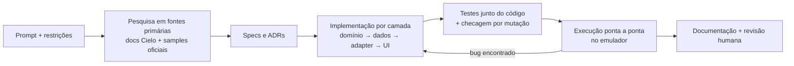

# Uso de IA na construção da solução

Este documento registra **como** a IA foi usada: ferramenta, harness, prompts, restrições, verificações e
os **achados que mudaram o design**. O objetivo foi usar a IA como engenheiro assistente sob regras
explícitas, não como gerador de código sem revisão.

## 1. Ferramenta e modo de uso

| Item | Detalhe |
|---|---|
| Agente | **Claude Code** (modelo Claude Opus 5.5), em modo agêntico, com acesso a terminal, web e emulador Android (`adb`) |
| Harness | [`CLAUDE.md`](../../CLAUDE.md) (regras e invariantes), [`docs/specs`](../specs) (comportamento), [`docs/adr`](../adr) (decisões) |
| Papel humano | Definir o objetivo e as restrições, aprovar decisões, revisar código e documentação, responder pela entrega |
| Papel da IA | Pesquisar fontes primárias, propor e registrar decisões, implementar, testar, verificar no emulador e documentar |

## 2. Fluxo de trabalho (spec-driven)



Cada camada só avançou com os testes da anterior verdes: domínio (32) → dados (8) → adapter Cielo (12) → simulador (5) → app (9).

## 3. Prompts

### 3.1 Prompt do desenvolvedor (entrada real da sessão)

> Contexto: descrição da vaga Android da Cielo + enunciado completo do desafio "App de Venda de
> Ingressos com Cielo Lio" (escopo, requisitos funcionais e não funcionais, restrições, materiais
> obrigatórios e itens de entrega).
>
> Instrução: **"QUERO QUE APLIQUE OS CONCEITOS DE QUALIDADE DE SOFTWARE incluindo SOLID, Clean Code e Clean Architecture"**.

Na mesma sessão, depois da primeira versão funcionando:

> **"aplique a identidade visual que eu criei no app da cielo"** (com a pasta do projeto Figma Make
> "Visual Identity for Ticket App" anexada) e, em seguida, **"pode remover a parte de perfil.. deixe só
> início e ingressos"**.

### 3.2 Decomposição feita pelo agente

O agente transformou o prompt em um plano verificável. Estas são as subtarefas e o critério de "pronto"
de cada uma:

| # | Subtarefa | Critério de pronto |
|---|---|---|
| 1 | Inspecionar o ambiente (JDK, SDK, AVDs, caches do Gradle) | Versões escolhidas compatíveis com o que existe localmente |
| 2 | Ler a documentação Cielo Smart **a partir do índice `llms.txt`** e os samples oficiais no GitHub | Contrato de request/response, códigos de erro, manifest e política de integração confirmados na fonte |
| 3 | Escrever specs e ADRs | Invariantes de pagamento explícitos antes do código |
| 4 | Domínio puro + testes | Máquina de estados e casos de uso cobertos; teste de concorrência **falha sem o lock** |
| 5 | Room + adapter Cielo + testes | Parser validado com os **payloads publicados na documentação** |
| 6 | UI Compose + simulador de terminal | Fluxo completo executado no emulador |
| 7 | Documentação e harness | README com todos os itens pedidos no desafio |
| 8 | Ler a identidade visual (CSS + protótipo React) e extrair tokens, tipografia, ícones e componentes | Design system em `ui/designsystem`; nenhuma tela com cor ou ícone fora dele ([ADR-0009](../adr/0009-design-system-identidade-visual.md)) |
| 9 | Reaplicar o visual sem tocar em domínio/ViewModels | Testes verdes; todos os estados verificados de novo no emulador |

### 3.3 Prompts reutilizáveis (templates para evoluir o projeto com o mesmo harness)

```text
Implemente <funcionalidade> seguindo CLAUDE.md. Antes de codar:
1) leia a página oficial da Cielo correspondente (via llms.txt) e cite-a;
2) atualize/crie a spec em docs/specs e, se houver decisão nova, um ADR;
3) escreva primeiro os testes de domínio que expressem os critérios de aceite.
Não altere invariantes de pagamento sem um teste que falhe antes da mudança.
```

```text
Revise o diff atual contra os invariantes de pagamento do CLAUDE.md. Para cada invariante,
aponte o teste que o protege ou diga explicitamente que não há cobertura.
```

## 4. Restrições impostas à IA

Vindas do desafio e do `CLAUDE.md`:

- Kotlin + Android nativo; integração **somente** pela camada de abstração da Cielo (`lio://`). SDK de fabricante proibido.
- Domínio sem Android, sem Room e sem anotações de DI (a regra de dependência é verificada pelo compilador).
- Dinheiro em centavos (`Long`); nunca `Double`.
- Credenciais fora do git; nada sensível em logs/telemetria.
- Toda regra de pagamento acompanhada de teste. **Proibido** alterar teste para "passar".
- Afirmações sobre a API da Cielo **precisam de fonte** (página da documentação ou sample oficial).
- Nada de push, repositório remoto ou publicação sem pedido explícito do desenvolvedor.

## 5. Resultados que orientaram a implementação

Achados da pesquisa e da verificação, e a decisão que cada um gerou:

| # | Achado (fonte) | Impacto no design |
|---|---|---|
| 1 | Política da Cielo: **camada de abstração obrigatória**, proibido SDK do fabricante (doc "Política de integração") | Deep Link `lio://` ([ADR-0002](../adr/0002-deep-link-lio.md)) |
| 2 | `responsecode=0` aparece **também em respostas de erro** (doc "Códigos de erro") | Parser decide pelo formato do JSON, não pelo `responsecode` |
| 3 | Respostas de erro trazem só `{code, reason}`, **sem `reference`** | "Um pagamento pendente por vez" + correlação estrita por `reference` para aprovações ([ADR-0003](../adr/0003-idempotencia-e-maquina-de-estados.md)) |
| 4 | Exemplos da documentação com **Base64 quebrado em linhas**; sample oficial usa `NO_WRAP` + `Uri.Builder` | Encoder sem quebras + percent-encoding; decoder tolerante a `\n` e `+`→espaço |
| 5 | Exemplos usam `order://response` (genérico) | Esquema exclusivo e sem `BROWSABLE` ([ADR-0007](../adr/0007-seguranca-do-callback.md)) |
| 6 | FAQ: transações "não retornam" quando o app de integração é morto | Persistir antes de despachar + banco como fonte da verdade, **testado matando o processo** ([ADR-0004](../adr/0004-room-fonte-unica-da-verdade.md)) |
| 7 | Emulador Cielo só roda em Android 7.1/10 | Flavor `simulator` falando o mesmo protocolo ([ADR-0005](../adr/0005-flavor-simulador-de-terminal.md)) |
| 8 | Terminais com Android 7.1 a 12 e 1 a 2 GB de RAM (doc "Terminais") | `minSdk 25`, desugaring de `java.time`, UI leve |
| 9 | FAQ: `cs_integration_type=uri` exigido pela Cielo Store | `meta-data` no manifest |
| 10 | `statusCode` 0 = Pix, 1 = autorizado, 2 = cancelamento | Só pagamentos 0/1 contam como aprovação |
| 11 | Protótipo da identidade separa resumo e pagamento em telas e usa fotos remotas e DM Sans via Google Fonts | Mantido o checkout único (mínimo de passos), cards sem foto (offline-first) e fonte parametrizada para terminais sem Google Play Services ([ADR-0009](../adr/0009-design-system-identidade-visual.md)) |

## 6. Erros da IA detectados e corrigidos (verificação crítica)

Estas correções mostram por que a saída da IA foi verificada, e não aceita como estava:

| Problema | Como foi detectado | Correção |
|---|---|---|
| O teste de duplo toque **passava mesmo sem o `Mutex`** (o fake não suspendia, então nunca havia concorrência real) | Checagem por mutação: remover o lock e rodar o teste | O fake passou a suspender como I/O real (`yield`); hoje o teste falha sem o lock |
| `:app` não compilava porque `RoomDatabase` não estava no classpath | Build | Em vez de vazar o Room (`api`), criada a fachada `DataLayer`: o `:data` exporta só interfaces do domínio |
| Testes de ViewModel liam o estado antes de haver um assinante (`WhileSubscribed`) | Testes vermelhos | Assinatura eager com `UnconfinedTestDispatcher` |
| Banner "pagamento aguardando" ficava **escondido** acima da lista (`LazyColumn` mantém a posição de rolagem) | Execução no emulador | Banner fixo fora da lista |
| Simulador "fechando sozinho" | Execução no emulador + `logcat`/`dumpsys` | Era artefato do teste (dois `input tap` paralelos). Confirmado com toque único: **não era bug do app** |
| Atributos de escala no `<path>` do ícone (inválidos) | Revisão do código gerado | Escala movida para `<group>` |
| Avisos de lint (backup, ícone monocromático, KTX) | `./gradlew lint` | Corrigidos; falsos positivos (dicionário inglês em strings pt-BR) suprimidos com justificativa em `app/lint.xml` |
| Teste novo da busca afirmava que "jazz rio" não deveria casar, mas "rio" é substring de "Audi**tório**" | Teste vermelho; o código estava certo | Caso de teste corrigido ("jazz recife") |
| Barra inferior translúcida (96%, como no CSS) deixava o texto da lista aparecer por baixo, porque o Android não tem o `backdrop-filter` | Captura de tela no emulador | Barra sólida |

## 7. Evidências de verificação

- `./gradlew test`: **66 testes** verdes em 5 módulos.
- Execução no emulador (flavor `simulator`): aprovação, negação, cancelamento, terminal sem resposta com liberação, bloqueio de venda concorrente, callback repetido (ignorado), callback forjado (rejeitado) e **morte do processo durante o pagamento** (resultado gravado após o Android recriar o app). Capturas em [`docs/screenshots`](../screenshots).
- Telemetria observada no `logcat` durante os testes, por exemplo:
  `PaymentDispatched` → `PaymentResolved(APPROVED)`, `CallbackIgnored(APPROVED)`, `CallbackUnmatched(forged-reference)`, `ConcurrentPaymentBlocked`, `PurchaseReleased`.
- Lint: 0 erros.

## 8. Pontos de revisão humana

Responsabilidade do desenvolvedor antes da entrega e na apresentação:

1. Validar o flavor `cielo` no **Emulador Cielo oficial** (AVD API 29). Não foi executado no ambiente do agente.
2. Revisar os ADRs e defender os trade-offs (sem foreground service, `UNCONFIRMED` manual, sem backend).
3. Conferir textos de UX com o time de produto/design.
4. Confirmar com a Cielo se o `reference` é sempre devolvido no callback de aprovação em produção. O design já cobre o caso contrário (fallback pela compra pendente + checagem de valor).

## 9. Números

| Métrica | Valor |
|---|---|
| Módulos Gradle | 5 (`app`, `domain`, `data`, `payment:cielo`, `payment:simulator`) |
| Arquivos Kotlin | ~85 (~5.900 linhas, das quais ~1.300 de teste) |
| Testes automatizados | 66 |
| ADRs / Specs | 9 / 3 |
